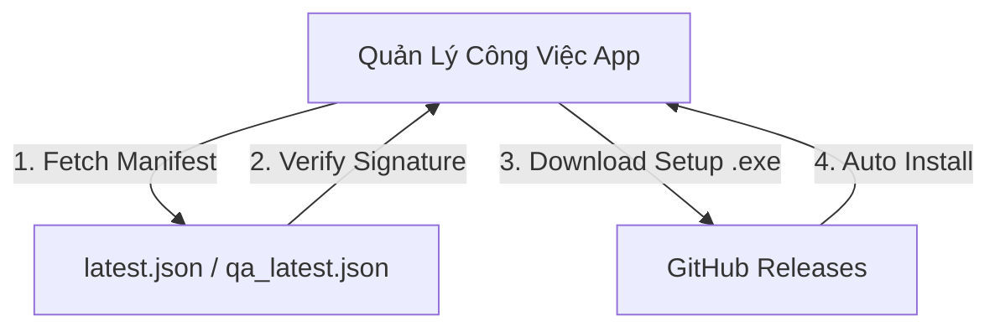

# Quản Lý Công Việc Desktop - Auto-Updater Repository

Kho lưu trữ cấu hình cập nhật tự động (Auto-Updater Manifests) và phát hành phiên bản (Releases) cho ứng dụng **Quản Lý Công Việc Desktop** (Tauri v2).

---

## 📌 Tổng Quan Architecture

Repository này đóng vai trò làm trung tâm phân phối bản cập nhật tự động cho các máy trạm sử dụng **Quản Lý Công Việc Desktop**.



---

## 📁 Cấu Trúc Repository

```text
.
├── .github/
│   └── workflows/
│       ├── build-desktop.yml   # Workflow tự động build, ký số & cập nhật manifest
│       └── cleanup-runs.yml    # Dọn lịch sử GitHub Actions hằng ngày
├── latest.json                 # Manifest cập nhật tự động cho môi trường Production
├── qa_latest.json              # Manifest cập nhật tự động cho môi trường Staging / QA
├── settings.json               # Cấu hình hiển thị thông báo & điều hướng cập nhật phía App
├── versions.json               # Danh sách và nhật ký các phiên bản đã phát hành
└── README.md
```

## 🧹 Dọn lịch sử Actions

`.github/workflows/cleanup-runs.yml` dùng [`igorjs/gh-actions-clean-workflow`](https://github.com/igorjs/gh-actions-clean-workflow) (ghim SHA),
chạy **hằng ngày 02:17 UTC** hoặc chạy tay (mặc định `dry_run = true` để xem trước).
Chỉ xoá run **đã hoàn thành** cũ hơn `runs_older_than` ngày (mặc định 7); trong số đó giữ lại `runs_to_keep` run mới nhất
của mỗi workflow (mặc định 3). `workflow_names` (tuỳ chọn) giới hạn theo tên workflow.
Mỗi lần chạy xoá tối đa ~1000 run (giới hạn API GitHub); lịch hằng ngày dọn dần phần tồn đọng.
